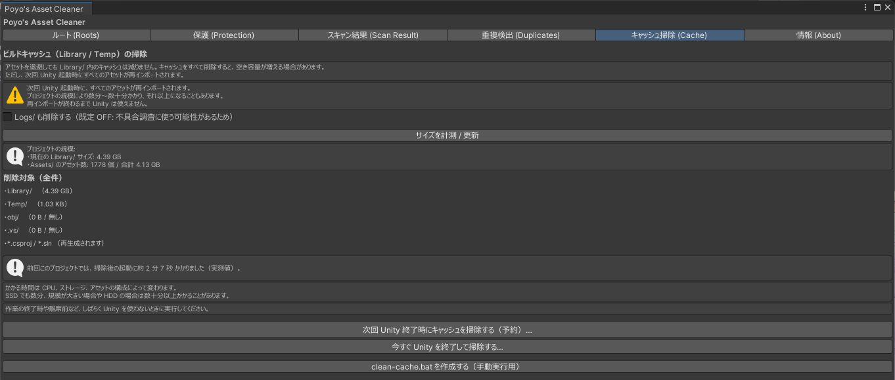

# キャッシュ掃除

「キャッシュ掃除 (Cache)」タブでは、`Library/` などのキャッシュを削除してディスクの容量を空けます。アセットを退避しても `Library/` は小さくならないため、別に用意しています。Windows 専用です。

!!! warning
    キャッシュを削除すると、次に Unity を起動したときに、すべてのアセットのインポートがやり直しになります。プロジェクトの大きさによって、数分から数十分以上かかります。終わるまで Unity は使えません。

## 削除するもの

| 対象 | 備考 |
|---|---|
| `Library/` | インポートし直すと作り直されます |
| `Temp/` | |
| `obj/` | |
| `.vs/` | |
| `*.csproj` / `*.sln` | 作り直されます |
| `Logs/` | 「Logs/ も削除する」をオンにしたときだけ削除します。既定はオフです |

`Assets/`、`Packages/`、`ProjectSettings/` は削除しません。

## 使い方

Unity を起動している間は `Library/` を削除できません。そのため、掃除を予約し、Unity を終了したときに別のプログラムが削除します。

1. 「サイズを計測 / 更新」を押します。`Library/` のサイズと、`Assets/` のアセットの数・合計サイズが出ます。`Assets/` が大きいほど、インポートのやり直しに時間がかかります。

    { .shot loading=lazy }

2. 「次回 Unity 終了時にキャッシュを掃除する（予約）…」を押します。確認ウィンドウが開くので、「次へ（最終確認）」を押し、「再インポートに時間がかかることを理解しました」にチェックを入れて「予約する」を押します。
3. いつもどおり Unity を終了します。終了するときに確認が出るので、「掃除して終了」を押します。
4. 次に Unity を起動すると、インポートのやり直しが始まります。かかった時間は記録され、次からはタブに目安として表示されます。

作業を終えるときや、しばらく Unity を使わないときに予約するのがおすすめです。

予約は「予約をキャンセルする」で取り消せます。終了するときの確認で「予約を取り消して終了」を押しても取り消せます。

## ほかの実行方法

| ボタン | 内容 |
|---|---|
| 今すぐ Unity を終了して掃除する… | 確認のあと Unity を終了し、すぐに削除します |
| clean-cache.bat を作成する（手動実行用） | 予約がうまく動かないときに使います。プロジェクト直下にバッチファイルを作るので、Unity を終了してから実行します |

## よくある質問

### どのくらい時間がかかりますか

パソコンの性能とアセットの量で大きく変わります。SSD でも数分、プロジェクトが大きいときや HDD のときは数十分以上かかることがあります。一度掃除すると、次からはそのプロジェクトでかかった時間が表示されます。

### インポートの途中で Unity を終了するとどうなりますか

次に起動したときに続きから始まります。プロジェクトが壊れることはありませんが、かかる時間は短くなりません。
