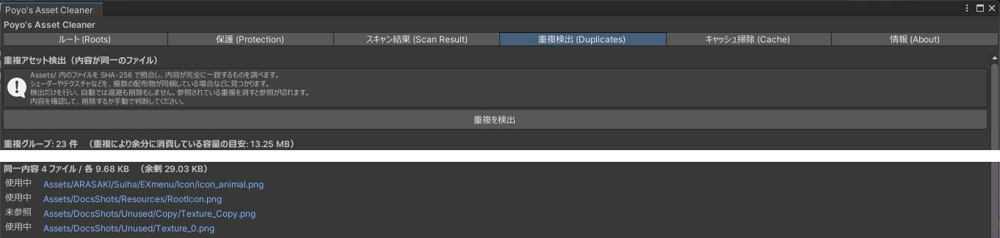

# 重複の検出

「重複検出 (Duplicates)」タブでは、`Assets/` の中から内容がまったく同じファイルを探します。複数の配布物が同じシェーダーやテクスチャを同梱しているときなどに見つかります。

## 使い方

「重複を検出」を押します。ファイルの中身を SHA-256 で比べるため、プロジェクトが大きいと時間がかかります。

内容が同じファイルが、組ごとに並びます。

{ .shot loading=lazy }

| 表示 | 内容 |
|---|---|
| 同一内容 N ファイル / 各 サイズ | 同じ内容のファイルの数と、1 つあたりのサイズです |
| 余剰 | 1 つだけ残したときに空く容量です |
| 使用中 / 未参照 | そのファイルが参照されているかどうかです |

このタブは結果を表示するだけで、ファイルを移動も削除もしません。

## 見つかった重複の扱い

内容が同じでも、ファイルごとに GUID が違います。片方を消すと、それを参照していたマテリアルや Prefab の参照が切れます。

| 状況 | 扱い |
|---|---|
| すべて「未参照」 | どこからも使われていません。[スキャン](scan.md)で候補に出ていれば、そちらで退避できます |
| 1 つが「使用中」、ほかが「未参照」 | 未参照のものは整理できることがあります。配布物のフォルダの中にあるなら、そのフォルダごと要らないかを確かめてください |
| 2 つ以上が「使用中」 | それぞれ別のものから参照されています。そのままにしてください |

配布物のフォルダから 1 ファイルだけを消すと、その配布物をインポートし直したときに戻ってきます。

1 つにまとめたいときは、参照している側（マテリアルや Prefab）を残すほうのファイルに差し替えてから、要らなくなったほうを退避してください。このツールは参照の差し替えをしません。
