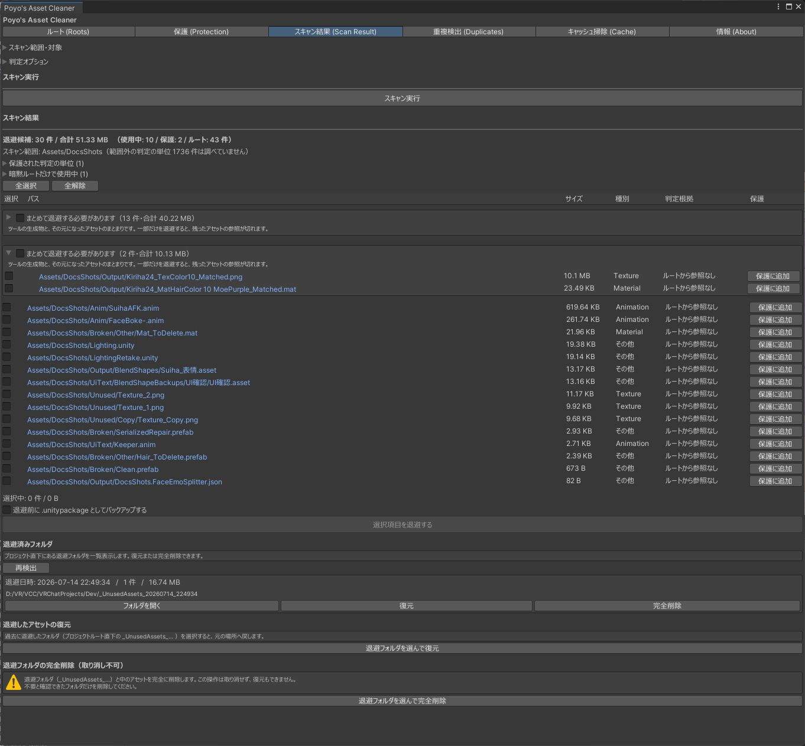

# はじめに

Poyo's Asset Cleaner は、VRChat のアバター改変用 Unity プロジェクトで、どのアバターからも参照されていないアセットを探して片付けるエディタ拡張です。

{ .shot loading=lazy }

## できること

- 登録したアバターやシーンから参照をたどり、使われていないアセットを一覧にする
- 選んだアセットを `.meta` ごとプロジェクト直下の `_UnusedAssets_日時/` フォルダへ移す（このドキュメントでは「退避」と呼びます）。退避したものは元の場所へ戻せます
- 退避したフォルダを完全に削除する
- 内容が同じファイルを探す
- `Library/` などのキャッシュを削除する（Windows のみ）

## 候補に出ないもの

参照をたどるだけでは使っているかどうかを判断できないアセットがあります。たとえばスクリプトから名前で読み込まれるものです。そのため、次のものは未使用でも候補に出しません。

- スクリプト・シェーダー・パッケージ定義を含むフォルダや、VRChat SDK・lilToon・Modular Avatar などのツールのフォルダ（[保護](protection.md)）
- 使用中のアセットを 1 つでも含む配布物のフォルダ（[スキャンの設定](scan.md#judge)）

使っていないアセットがすべて候補に出るわけではありません。
