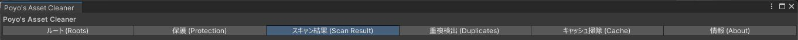

# インストール

## 動作環境

| 項目 | 要件 |
|---|---|
| Unity | 2022.3 |
| VRChat SDK | Avatars 3.7.0 以上 |
| OS | Windows（キャッシュ掃除は Windows のみ） |

VRChat SDK はアバターの自動検出に使います。SDK が無くても、アバターのフォルダを手で登録すれば使えます。

## VCC / ALCOM から入れる

1. VCC または ALCOM に `https://vpm.maaaaa.net/index.json` を追加します。
2. プロジェクトの Manage Packages を開き、「Poyo's Asset Cleaner」を追加します。

## .unitypackage から入れる

[リリースページ](https://github.com/Poyotoron/Asset-Cleaner/releases)から `.unitypackage` をダウンロードし、Unity にドラッグ＆ドロップしてインポートします。

## 開き方

メニューの `Tools > Poyo's Asset Cleaner` でウィンドウが開きます。ウィンドウには 6 つのタブがあります。

{ .shot loading=lazy }

| タブ | 内容 |
|---|---|
| ルート (Roots) | 使用中かどうかを判定する起点を登録します（[ルートの設定](roots.md)） |
| 保護 (Protection) | 候補に出さないものの一覧と、自分で追加する保護です（[保護](protection.md)） |
| スキャン結果 (Scan Result) | スキャン、退避、復元、完全削除をします（[スキャンと退避](scan.md)） |
| 重複検出 (Duplicates) | 内容が同じファイルを探します（[重複の検出](duplicates.md)） |
| キャッシュ掃除 (Cache) | `Library/` などを削除します（[キャッシュ掃除](cache.md)） |
| 情報 (About) | バージョン、不具合の報告先です |

## 設定の保存先

登録したルートや保護の設定は `Assets/zzz_pytr/Asset-Cleaner/Settings.asset` に保存されます。

## アンインストール

VCC / ALCOM の Manage Packages で削除します。設定ファイルは残るので、不要なら `Assets/zzz_pytr/Asset-Cleaner/` を削除してください。

退避フォルダ（`_UnusedAssets_…`）を元に戻すにはこのツールが必要です。戻すものがあれば、アンインストールの前に戻してください。
