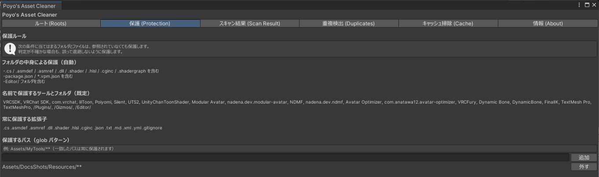
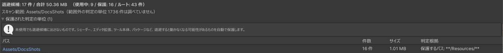

# 保護

スクリプトから名前で読み込まれるアセットや、エディタ拡張が使うファイルは、参照をたどっても見つかりません。このようなものを退避すると壊れることがあるため、次の条件に当てはまるものは、参照が無くても候補に出しません。これを「保護」と呼びます。

## 自動で保護するもの

「保護 (Protection)」タブで、自動で保護する条件を確かめられます。

{ .shot loading=lazy }

| 条件 | 例 |
|---|---|
| スクリプトやシェーダーを含むフォルダ | `.cs` `.asmdef` `.asmref` `.dll` `.shader` `.hlsl` `.cginc` `.shadergraph` |
| パッケージ定義を含むフォルダ | `package.json` `*.vpm.json` |
| `Editor/` フォルダを持つフォルダ | |
| 既知のツールの名前を含むパス | VRChat SDK、lilToon、Poiyomi、Modular Avatar、NDMF、Avatar Optimizer、VRCFury、`/Plugins/` など |
| 特定の拡張子のファイル | `.json` `.txt` `.md` `.xml` `.yml` など |
| このツールの設定フォルダ | `Assets/zzz_pytr/Asset-Cleaner/` |

保護はフォルダ単位です。フォルダの中にスクリプトが 1 つでもあれば、そのフォルダ全体を保護します。変換ツールが作ったファイルがツール本体と同じフォルダにあって候補に出ないときは、[ツール出力フォルダ](scan.md#tool-output)を登録してください。

保護を全部まとめて外す設定はありません。

## 自分で保護を追加する

「保護するパス（glob パターン）」にパターンを入れて「追加」を押すと、一致するパスを保護します。

```
Assets/MyTools/**
Assets/自作/衣装素材/**
```

スキャン結果の各行にある「保護に追加」を押しても、その行のパスが追加されます。

## 保護したものを確かめる { #protected-units }

スキャン結果の「保護された判定の単位」を開くと、保護したため候補に出さなかったものと、その理由が並びます。候補が 0 件のときも表示されます。

{ .shot loading=lazy }

主な理由は次のとおりです。

| 判定根拠 | 内容 |
|---|---|
| コードやシェーダーを含む（拡張子） | スクリプトやシェーダーを含むフォルダです |
| パッケージの定義ファイルを含む（ファイル名） | `package.json` などを含むフォルダです |
| Editor/ フォルダを含む | エディタ拡張のフォルダです |
| 名前で保護: 名前 | 既知のツールのフォルダです |
| 保護するパス: パターン | 自分で追加した保護に一致しました |
| このツールの設定フォルダ | このツールの設定です |
| スキャンの起点（暗黙ルート）として保護 | [暗黙ルート](roots.md#implicit)そのものです |
| ルートから外したファイルを含むため保護 | 暗黙ルートから外したファイルを含んでいます |

## 保護で防げないもの

スクリプトの中に文字列でパスが書かれている場合や、ツールが独自のしくみでファイルを読み込む場合は、保護の条件に当てはまらないことがあります。退避したあとにおかしいところがあれば、[復元](scan.md#restore)してください。
