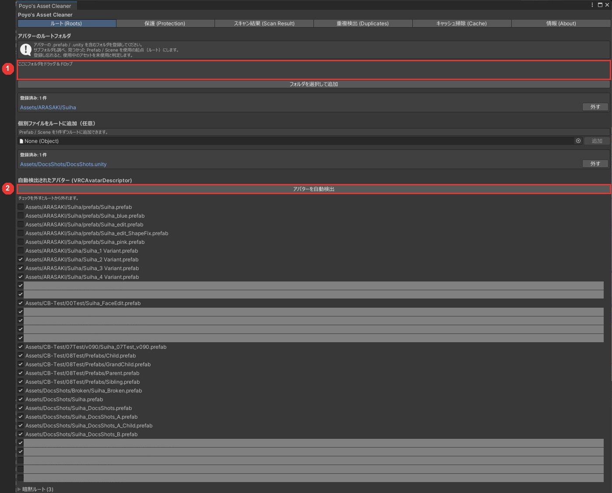
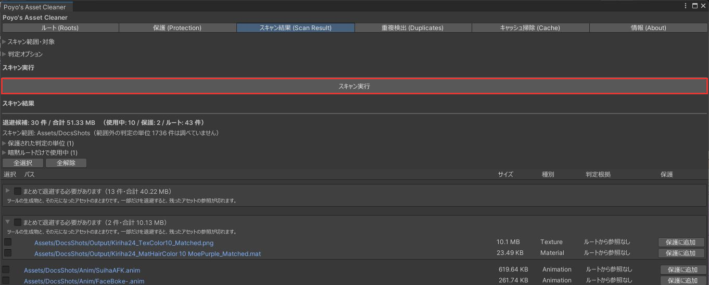
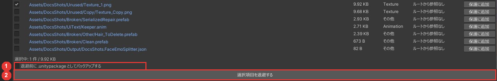

# クイックスタート

ルートを登録し、スキャンして、不要なものを退避するまでの手順です。初めて使うときは、プロジェクトのフォルダをコピーしてから試すことをおすすめします。

## 1. ルートを登録する

`Tools > Poyo's Asset Cleaner` でウィンドウを開き、「ルート (Roots)」タブで「アバターを自動検出」を押します。`VRCAvatarDescriptor` が付いた Prefab が一覧に出ます。

一覧に無いアバターがあれば、その Prefab やシーンを含むフォルダを「ここにフォルダをドラッグ＆ドロップ」の欄にドロップします。

{ .shot loading=lazy }

!!! warning
    まだ使うアバターを登録し忘れると、そのアバターが使っている衣装やテクスチャが候補に出ます。迷うものは登録してください。

## 2. スキャンする

「スキャン結果 (Scan Result)」タブで「スキャン実行」を押します。スキャンではファイルは動きません。

{ .shot loading=lazy }

候補がサイズの大きい順に並びます。パスをクリックすると、Project ウィンドウでそのアセットが選択されます。使っているものが混ざっていないかを確かめてください。

## 3. 退避する

1. 退避するものにチェックを入れます。最初はどれにもチェックが入っていません。
2. 必要なら「退避前に .unitypackage としてバックアップする」をオンにします。
3. 「選択項目を退避する」を押し、確認ダイアログで「退避する」を押します。

{ .shot loading=lazy }

選んだものは、プロジェクト直下の `_UnusedAssets_日時/` フォルダへ移ります。

## 4. 確かめる

Console に Missing の警告が出ていないか、アバターの見た目が変わっていないかを確かめます。

おかしければ、同じタブの下にある「退避済みフォルダ」で「復元」を押すと元に戻ります（[退避したものを戻す](scan.md#restore)）。
