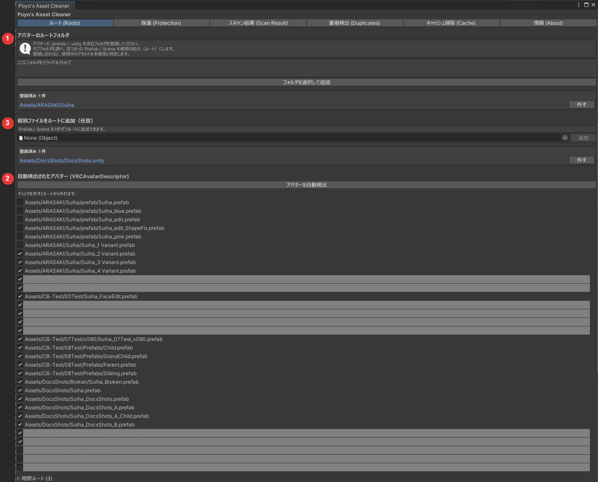
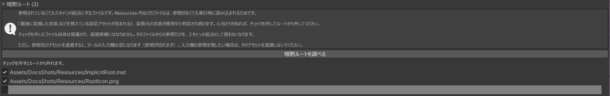

# ルートの設定

アセットが使用中かどうかは、ルートとして登録した Prefab とシーンから参照をたどって決めます。たどり着けたアセットは使用中、たどり着けなかったアセットは退避の候補になります。

まだ使うアバターをルートに入れ忘れると、そのアバターだけが使っているアセットが候補に出ます。

## 登録のしかた

「ルート (Roots)」タブで登録します。登録のしかたは 3 つあり、組み合わせて使えます。

{ .shot loading=lazy }

### 1. フォルダを登録する

「アバターのルートフォルダ」の欄に、アバターの Prefab やシーンを含むフォルダをドロップします。「フォルダを選択して追加」からも選べます。

フォルダの中はサブフォルダまで調べ、見つかった Prefab とシーンをすべてルートにします。

### 2. アバターを自動検出する

「アバターを自動検出」を押すと、`VRCAvatarDescriptor` が付いた Prefab をプロジェクト全体から探して一覧にします。

- 一覧のものは、すべてルートになります。
- チェックを外したものはルートから外れます。もう使わないアバターの衣装を候補に出したいときに外します。

VRChat SDK が入っていないときや、Prefab に `VRCAvatarDescriptor` が付いていないときは検出されません。フォルダか個別ファイルで登録してください。

### 3. 個別ファイルを追加する

「個別ファイルをルートに追加（任意）」の欄に、Prefab かシーンを 1 つずつ指定します。

## 暗黙ルート { #implicit }

次のものは、登録しなくてもルートとして扱います。参照が無くても、実行時やツールから読み込まれることがあるためです。

| 対象 | 理由 |
|---|---|
| `Resources/` の中 | スクリプトから名前で読み込まれる |
| `Editor Default Resources/` の中 | 同上 |
| `StreamingAssets/` の中 | 同上 |
| Build Settings に入っているシーン | ビルドの対象になる |
| `Assets/` の直下にある `.asset` | ツールの設定ファイルであることが多い |

「暗黙ルート」を開いて「暗黙ルートを調べる」を押すと、該当するファイルの一覧が出ます。

{ .shot loading=lazy }

### 暗黙ルートから外す

一覧のチェックを外したファイルは、ルートとして扱わなくなります。

衣装変換ツールなどの設定ファイルが、最後に変換した衣装への参照を持ち続けていることがあります。この設定ファイルが暗黙ルートになっていると、その衣装はもう使っていなくても使用中と判定されます。この場合は、設定ファイルのチェックを外すと衣装が候補に出ます。

- チェックを外したファイルそのものは候補に出ません（保護されます）。
- そのファイルからしか参照されていないアセットは候補に出ます。退避すると、ツールの入力欄などが空になります。

スキャン結果の「暗黙ルートだけで使用中」にも、暗黙ルートからしか参照されていないものが並びます。こちらの「ルートから外す」でも、同じように外せます（[スキャン結果の見かた](scan.md#result)）。

## ルートが 1 つも無いとき

ルートが 1 つも無いとスキャンできません。すべてのアセットが候補になってしまうためです。この場合はメッセージが出てスキャンが止まります。
