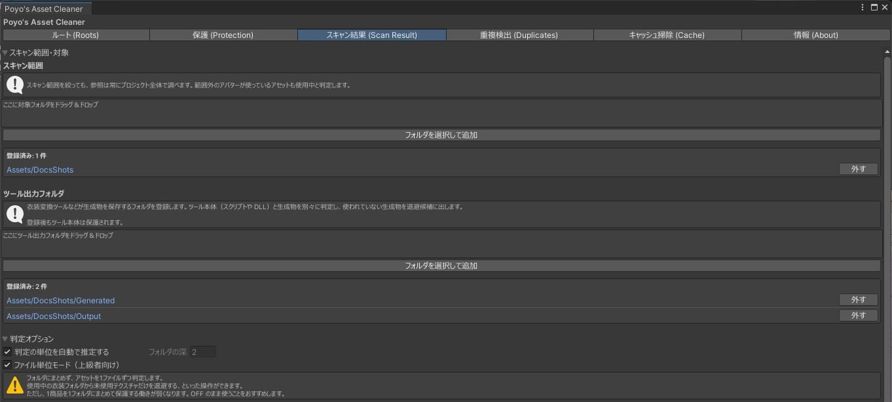
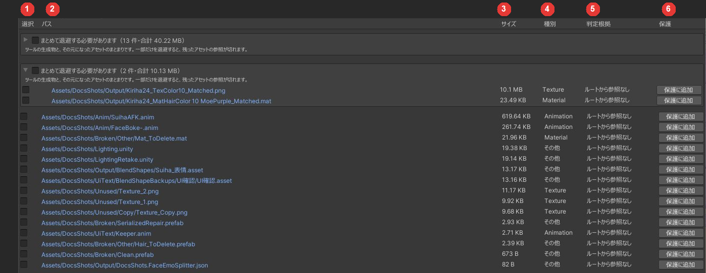
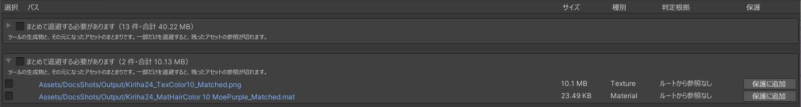
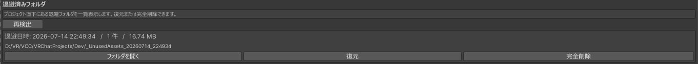

# スキャンと退避

「スキャン結果 (Scan Result)」タブで、スキャン、退避、復元、完全削除をします。先に[ルートの設定](roots.md)を済ませてください。

## スキャンの設定

「スキャン範囲・対象」と「判定オプション」を開くと、次の設定があります。どれも設定しなくてもスキャンできます。

{ .shot loading=lazy }

### スキャン範囲

フォルダを登録すると、そのフォルダの中のものだけを候補に出します。登録しなければプロジェクト全体が対象です。

範囲を絞っても、参照はプロジェクト全体からたどります。範囲の外のアバターが使っているアセットは、範囲の中にあっても候補に出ません。

### ツール出力フォルダ { #tool-output }

衣装変換ツールの中には、ツール本体（スクリプトや DLL）と変換で作ったファイルを同じフォルダに置くものがあります。スクリプトを含むフォルダは丸ごと[保護](protection.md)されるため、作ったファイルが使われていなくても候補に出ません。

ツールの出力先のフォルダを登録すると、その中を本体と分けて 1 ファイルずつ判定し、使われていないファイルを候補に出します。ツール本体と、出力先の中にあるスクリプトやシェーダーは、登録したあとも保護されたままです。

### 判定オプション { #judge }

| 設定 | 内容 |
|---|---|
| 判定の単位を自動で推定する | 既定でオンです。配布物 1 つ分のフォルダを推定し、フォルダ単位で判定します。中に使用中のアセットが 1 つでもあれば、フォルダごと残します |
| フォルダの深さ | 自動推定をオフにしたときに使います。`Assets/` から数えて指定した深さのフォルダを、判定の単位にします |
| ファイル単位モード（上級者向け） | フォルダ単位の判定をやめ、1 ファイルずつ判定します。既定はオフです |

ファイル単位モードでは、使用中の衣装のフォルダから、使われていないテクスチャだけを退避できます。そのかわり、配布物の一部だけが抜けた状態になることがあります。

## スキャン結果 { #result }

「スキャン実行」を押すとスキャンします。ファイルは動きません。候補はサイズの大きい順に並びます。

{ .shot loading=lazy }

| 番号 | 列 | 内容 |
|---|---|---|
| 1 | 選択 | 退避するものにチェックを入れます。最初はすべてオフです |
| 2 | パス | クリックすると Project ウィンドウで選択されます |
| 3 | サイズ | 退避すると空く容量です |
| 4 | 種別 | アセットの種類です |
| 5 | 判定根拠 | 候補になった理由です |
| 6 | 保護 | 「保護に追加」を押すと、そのパスを保護の一覧に加えます |

一覧の上には、折り畳まれた一覧が 2 つ出ることがあります。

| 一覧 | 内容 |
|---|---|
| 保護された判定の単位 | 保護したため候補に出さなかったものと、その理由です（[保護](protection.md#protected-units)） |
| 暗黙ルートだけで使用中 | アバターやシーンからは参照されておらず、暗黙ルートからだけ参照されているものです。「ルートから外す」を押すと、その暗黙ルートを外せます（[暗黙ルート](roots.md#implicit)） |

使っていないはずのものが候補に出ないときは、この 2 つを開いて理由を確かめてください。

### まとめて退避する必要がある候補

互いに参照し合っている候補は、「まとめて退避する必要があります」という 1 つのまとまりで表示されます。変換ツールが作ったファイルと、その元のマテリアルやテクスチャなどです。

{ .shot loading=lazy }

まとまりの中の 1 つにチェックを入れると、全部にチェックが入ります。一部だけを退避すると、残ったほうの参照が切れるためです。

## 退避する

1. 退避するものにチェックを入れます。
2. 必要なら「退避前に .unitypackage としてバックアップする」をオンにします。退避フォルダの中に `backup.unitypackage` を書き出してから退避します。
3. 「選択項目を退避する」を押し、確認ダイアログで「退避する」を押します。

選んだものは、プロジェクト直下の `_UnusedAssets_日時/` フォルダへ `.meta` ごと移ります。退避で空になったフォルダも一緒に移し、`Assets/` に空のフォルダを残しません。

退避したあとは、Console に Missing の警告が出ていないかを確かめてください。

## 退避したものを戻す・完全に削除する { #restore }

「退避済みフォルダ」に、プロジェクト直下の `_UnusedAssets_…` フォルダが一覧で出ます。スキャンしていなくても、Unity を再起動したあとでも出ます。

{ .shot loading=lazy }

| ボタン | 内容 |
|---|---|
| フォルダを開く | エクスプローラーで退避フォルダを開きます |
| 復元 | 中身を元の場所へ戻します。`.meta` ごと戻すので、参照も元に戻ります |
| 完全削除 | 退避フォルダを削除します。2 回確認が出ます |

- 戻す先に同じ `.meta` がすでにあるものは戻さず、退避フォルダに残します。
- 退避フォルダを別の場所へ動かした場合は、「退避フォルダを選んで復元」「退避フォルダを選んで完全削除」でフォルダを選びます。
- 完全削除できるのは、このツールが作った退避フォルダだけです。

!!! warning
    完全削除したものは戻せません。
