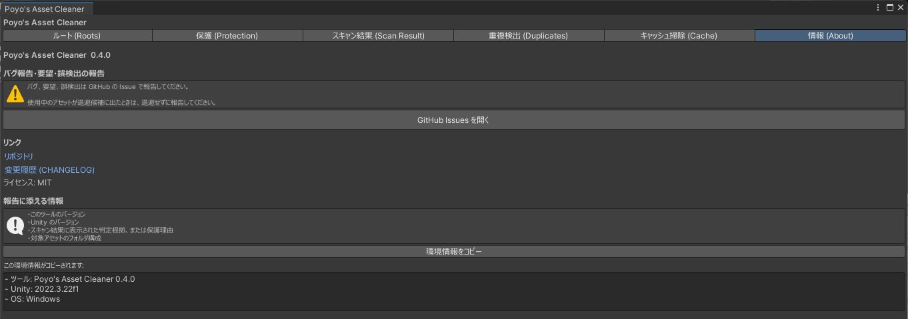

# 困ったときは

## 退避したらアバターがおかしくなった

「スキャン結果 (Scan Result)」タブの「退避済みフォルダ」で、該当する退避フォルダの「復元」を押してください。`.meta` ごと戻すので、参照も元に戻ります（[退避したものを戻す](scan.md#restore)）。

戻したら、そのアバターが[ルート](roots.md)に登録されているかを確かめてください。登録してからスキャンし直しても同じものが候補に出る場合は、誤った判定の可能性があります。[報告](#report)してください。

## 使っていないはずのものが候補に出ない

次の順に確かめてください。

1. スキャン結果の「保護された判定の単位」に入っていないか。入っていれば理由が書いてあります（[保護](protection.md#protected-units)）。
2. スキャン結果の「暗黙ルートだけで使用中」に入っていないか。ツールの設定ファイルから参照されているなら、「ルートから外す」で候補に出ます（[暗黙ルート](roots.md#implicit)）。
3. ルートタブの「自動検出されたアバター」に、もう使わないアバターが入っていないか。チェックを外すとルートから外れます。
4. 同じフォルダの中に使用中のアセットがないか。「判定の単位を自動で推定する」がオンのときは、使用中のアセットが 1 つでもあるフォルダは丸ごと残します（[判定オプション](scan.md#judge)）。

変換ツールが作ったファイルが候補に出ないときは、[ツール出力フォルダ](scan.md#tool-output)を登録してください。

変換した衣装をアバターに着せているときは、変換元のマテリアルやテクスチャも使用中です。この場合、変換元は候補に出ません。

## スキャンが止まる

ルートが 1 つも登録されていません。[ルートの設定](roots.md)をしてください。

## アバターが自動検出されない

VRChat SDK が入っていないか、Prefab に `VRCAvatarDescriptor` が付いていません。アバターのフォルダか Prefab を手で登録してください。

## 設定が消えた

設定は `Assets/zzz_pytr/Asset-Cleaner/Settings.asset` に保存されています。このファイルを消すと、設定は初期状態に戻ります。

## キャッシュ掃除の予約を取り消したい

「キャッシュ掃除 (Cache)」タブの「予約をキャンセルする」を押してください。Unity を終了するときの確認で「予約を取り消して終了」を押しても取り消せます。

## 報告する { #report }

不具合や要望は [GitHub Issues](https://github.com/Poyotoron/Asset-Cleaner/issues) に送ってください。「情報 (About)」タブの「GitHub Issues を開く」からも開けます。

{ .shot loading=lazy }

「環境情報をコピー」を押すと、このツールと Unity のバージョン、OS がコピーされます。報告に貼り付けてください。使っているアセットが候補に出た場合は、判定根拠と、そのアセットのフォルダ構成も書いてもらえると調べやすくなります。
